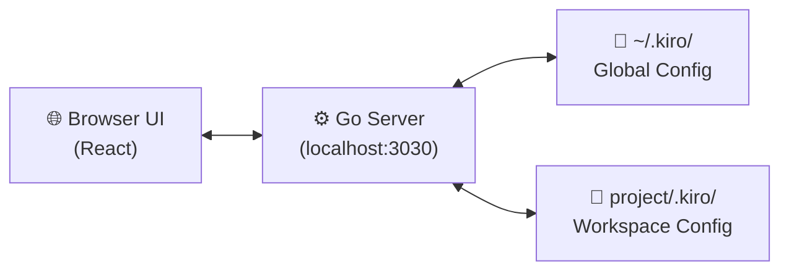

# Config Control for Kiro

> A local app for configuring Kiro CLI: agents, MCP servers, powers, permissions, sandbox, hooks, steering, skills, prompts, memory, specs, workflows, code intelligence, settings, Kiroignore, ACP, and chats and usage, for Global and for each Workspace.

https://github.com/user-attachments/assets/e8b1988c-e50e-4094-91cf-59050fb7a3f0

## What It Does and Who It's For

Config Control for Kiro is for anyone who uses Kiro CLI or sets up their Kiro experience. Create custom agents and upgrade older ones to Kiro CLI V3, connect MCP servers, install and build powers, and teach Kiro your way of working with steering, skills, prompts and memory. Set what Kiro may do with permissions and the sandbox, plan work with specs and workflows, set up code intelligence, follow your chat sessions and credit usage, and open a Kiro chat in one click to try it all, in one simple app instead of config files. Every file Kiro uses is at your fingertips, so you can find a setting fast, adjust it in seconds and get back to what matters: using Kiro's full AI suite.

## Quick Start

### Download a Release

Download, extract, and run on your OS:

| Platform | Download |
|---|---|
| Linux | [cckiro-linux-amd64.tar.gz](https://github.com/kirodotdev-labs/config-control-kiro/releases/latest/download/cckiro-linux-amd64.tar.gz) |
| macOS (Intel) | [cckiro-mac-intel.zip](https://github.com/kirodotdev-labs/config-control-kiro/releases/latest/download/cckiro-mac-intel.zip) |
| macOS (Apple Silicon) | [cckiro-mac-arm.zip](https://github.com/kirodotdev-labs/config-control-kiro/releases/latest/download/cckiro-mac-arm.zip) |
| Windows | [cckiro-windows-amd64.zip](https://github.com/kirodotdev-labs/config-control-kiro/releases/latest/download/cckiro-windows-amd64.zip) |

Or install from the terminal — **select your OS below:**

<details>
<summary>🐧 Linux</summary>

```bash
curl -L -o cckiro-linux-amd64.tar.gz https://github.com/kirodotdev-labs/config-control-kiro/releases/latest/download/cckiro-linux-amd64.tar.gz
tar xzf cckiro-linux-amd64.tar.gz
chmod +x cckiro
./cckiro
```

</details>

<details>
<summary>🍎 macOS (Apple Silicon)</summary>

```bash
curl -L -o cckiro-mac-arm.zip https://github.com/kirodotdev-labs/config-control-kiro/releases/latest/download/cckiro-mac-arm.zip
unzip cckiro-mac-arm.zip
open cckiro.app
```

</details>

<details>
<summary>🍎 macOS (Intel)</summary>

```bash
curl -L -o cckiro-mac-intel.zip https://github.com/kirodotdev-labs/config-control-kiro/releases/latest/download/cckiro-mac-intel.zip
unzip cckiro-mac-intel.zip
open cckiro.app
```

</details>

<details>
<summary>🪟 Windows</summary>

Download [cckiro-windows-amd64.zip](https://github.com/kirodotdev-labs/config-control-kiro/releases/latest/download/cckiro-windows-amd64.zip), extract the zip, then run:

```
cckiro.exe
```

</details>

The app opens in your browser automatically. If it doesn't, paste this into your browser:

```
http://127.0.0.1:3030
```

cckiro only listens on localhost — nothing is exposed to the network.

> ⚠️ **Security alerts when opening the app — this is normal.**
>
> Your OS may show a security warning on first run. **Select your OS below for the fix:**
>
> <details>
> <summary>🍎 macOS — Security warnings</summary>
>
> **Error 1:** *"cckiro" Not Opened — Apple could not verify "cckiro" is free of malware that may harm your Mac or compromise your privacy.*
>
> **Error 2:** *"cckiro" can't be opened because Apple cannot verify it is free from malware.*
>
> This is macOS blocking apps that haven't been notarized by Apple. It does not mean the app contains malware.
>
> **Fix (choose one):**
> 1. **Right-click** `cckiro` → **Open** → click **Open** in the dialog
> 2. Go to **System Settings → Privacy & Security** → scroll to Security → click **Open Anyway**
> 3. Run in terminal: `xattr -d com.apple.quarantine cckiro`
>
> Once allowed, macOS remembers your choice and won't ask again.
>
> **Managed devices:** If your Mac is managed by your organization and the above options are unavailable, ask your IT admin to whitelist `cckiro` via MDM or add it to the approved applications list.
>
> 📖 [Apple — Safely open apps on your Mac](https://support.apple.com/en-us/HT202491)
>
> </details>
>
> <details>
> <summary>🪟 Windows — SmartScreen and Firewall warnings</summary>
>
> **Error 1 — SmartScreen:** *"Windows protected your PC — Microsoft Defender SmartScreen prevented an unrecognized app from starting."*
> - Click **More info** → click **Run anyway** — the app will start normally
>
> **Error 2 — Firewall:** *"Do you want to allow public and private networks to access this app?"*
> - Click **Cancel** — cckiro runs on localhost only and does not need network access. The app will continue to work.
>
> **To permanently trust cckiro (optional):**
> 1. **Windows Security** → **Virus & threat protection** → **Manage settings** → **Exclusions** → add `cckiro.exe`
> 2. **Start** → type **"Allow an app through Windows Firewall"** → **Change settings** → **Allow another app** → browse to `cckiro.exe`
>
> **Managed devices:** If you see *"This setting is managed by your organization"*, contact your IT admin to whitelist `cckiro.exe`.
>
> 📖 [Microsoft — Add an exclusion to Windows Security](https://support.microsoft.com/en-us/windows/add-an-exclusion-to-windows-security-811816c0-4dfd-af4a-47e4-c301afe13b26)
> 📖 [Microsoft — Allow an app through Windows Firewall](https://support.microsoft.com/en-us/windows/risks-of-allowing-apps-through-windows-firewall-654559af-3f54-3dcf-349f-71ccd90bcc5c)
>
> </details>
>
> <details>
> <summary>🐧 Linux</summary>
>
> If you get *"Permission denied"*:
> ```bash
> chmod +x cckiro
> ```
>
> </details>

Use `--no-browser` to start without opening a browser.

### Build From Source

Requires Go 1.25+ and Node.js 22+.

```bash
make build    # builds frontend + Go binary
./cckiro       # run it
```

Other commands:

```bash
make dev      # frontend hot-reload + Go backend (for development)
make test     # Go tests (race detector) + frontend domain tests
make lint     # go vet, staticcheck, ESLint
make freshness # outdated dependencies + npm audit
make clean    # remove all build artifacts
make release  # full pipeline: security checks + all platform binaries
```

## How It Works

The app is a single Go binary that embeds a React frontend. When you run it, it starts an HTTP server on localhost and serves the UI. All configuration reads and writes go to your local `.kiro/` directories — nothing leaves your machine.

It supports two modes: **Global** (`~/.kiro/`) for user-wide settings, and **Workspace** (`<project>/.kiro/`) for project-specific overrides.



## Project Structure

```
├── main.go                  # Entry point: config, server start, graceful shutdown
├── internal/
│   ├── server/              # Routes, middleware (auth token, limits, headers), SPA + CSP
│   ├── system/              # Active scope, surface tree, models, system info, update check
│   ├── agent/               # Agent specs (.json/.md), order-preserving read/write
│   ├── mcp/                 # mcp.json and live tool discovery (stdio + HTTP clients)
│   ├── permissions/         # permissions.yaml rules
│   ├── sandbox/             # settings/sandbox.json
│   ├── fileexplorer/        # Read/write files, browse folders, resolve pasted paths
│   ├── launcher/            # Opens a terminal running a validated kiro-cli command
│   └── shared/              # ordered JSON, miniyaml, browser, utils
├── client/src/
│   ├── services/api.js      # The only network module
│   ├── data/                # React Query hooks over the API
│   ├── domain/              # Kiro V3 knowledge (tools, hooks, agents, MCP), unit-tested
│   ├── ui/                  # House components (editor frame, sections, code editor, dialogs)
│   ├── features/            # agents, mcp, hooks, permissions, sandbox, files, launcher, shell
│   ├── hooks/ contexts/     # Draft/JSON-document state, scope, unsaved-changes guard
├── build/                   # Release pipeline and signing scripts
└── Makefile
```

## Resources

### ⚡ Create an Agent in 30 Seconds

https://github.com/user-attachments/assets/78b4de1d-4b1d-4f04-a65b-3b75facc1795

### 🎮 KiroPong

Run this workshop in your organization to explore Config Control for Kiro and Kiro CLI features — 45 minutes, no AWS account required.


- 📖 [Workshop Deck](https://cckiro.github.io/assets/kiropong/kiropong.html) — Multi-Agent Configuration with Config Control for Kiro (interactive slides)
- 🔗 [Workshop](https://catalog.us-east-1.prod.workshops.aws/workshops/9a6b7a99-a5dd-47d5-b6d4-4ec1830d0c7f/en-US) — Hands-on workshop (45 minutes, no AWS account required)

🎮 **KiroPong** — Built with a governed multi-agent system in cckiro

https://github.com/user-attachments/assets/28d21030-2e19-4b66-b0a8-96dfa4a48055

## Contributing

We welcome contributions! Report bugs and feature requests via [GitHub Issues](../../issues). See [CONTRIBUTING.md](CONTRIBUTING.md) for the full guide.

The short version: fork the repo → create a branch → make your changes → open a PR to `main`.

## Platform Support

Works on Linux, macOS, and Windows (via WSL). The app detects your environment automatically:

- **Linux** — Native support
- **macOS** — Native support (Intel + Apple Silicon)
- **WSL** — Detects WSL, handles path translation, launches PowerShell terminals
- **Windows** — Run the `.exe` directly or through WSL
